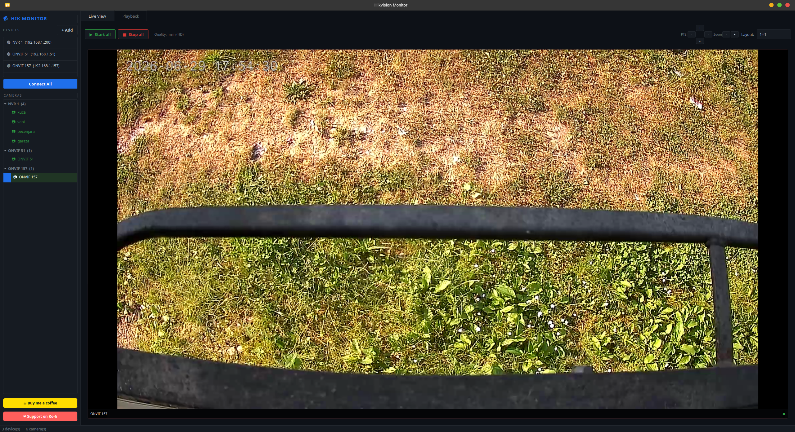

# Hik Monitor

A Linux desktop app for viewing and recording Hikvision, Safire and ONVIF NVR cameras.
I wrote it for my own NVR because iVMS-4200 has no proper Linux build.



## Features

- Live view with 1×1, 2×2, 3×3, 4×4, 1+3 and 1+7 grid layouts
- Recording playback with timeline scrubbing and 0.25×–8× speed
- Multiple NVRs, drag any camera into any grid cell
- Native Hikvision/Safire (HCNetSDK), generic ONVIF, and manual RTSP
- Hik-Connect cloud: sign in with your Hik-Connect account and watch live view
  and recordings from anywhere — no port forwarding, no SDK
- GPU-accelerated decoding via VAAPI when available
- Dark theme

ONVIF and RTSP cameras work without any SDK. For native Hikvision/Safire devices
the app uses the Hikvision HCNetSDK, which it offers to download on first use.

## Install

### Flatpak (any distro)

Grab `Hik-monitor-x86_64.flatpak` from the [latest release](https://github.com/manutdsnake/Hik-monitor/releases/latest):

```bash
flatpak remote-add --if-not-exists --user flathub https://flathub.org/repo/flathub.flatpakrepo
flatpak install --user ./Hik-monitor-x86_64.flatpak
flatpak run io.github.manutdsnake.Hik-monitor
```

### Debian / Ubuntu

```bash
curl -fsSL https://raw.githubusercontent.com/manutdsnake/Hik-monitor/main/install.sh | bash
```

### From source

```bash
sudo apt install ffmpeg python3 python3-pip python3-venv
git clone https://github.com/manutdsnake/Hik-monitor.git
cd Hik-monitor
pip install PyQt5 requests opencv-python numpy pycryptodome
pip install pyezvizapi   # Hik-Connect cloud streaming (Python 3.12+)
python3 hik_monitor2.py
```

## Usage

Click **+** in the sidebar to add a device:

- **NVR (Hikvision / Safire)** — IP, port, username, password
- **Scan ONVIF network** — auto-discover ONVIF cameras
- **Manual RTSP URL** — anything else
- **Hik-Connect account (cloud)** — the email/phone and password you use in the
  Hik-Connect mobile app

Click **Save**, then **Connect All**. Cameras appear in the sidebar; click or drag
them into the grid to start streaming.

## Hik-Connect cloud

Devices on your Hik-Connect account can be viewed through the Hikvision cloud
relay, the same way the mobile app does it: live view (main and sub stream,
H.264/H.265), recording search and playback from the NVR's disk, and cloud
snapshots. Useful for an NVR at another location without a VPN or open ports.

- It uses the unofficial Hik-Connect API — it may break if Hikvision changes it.
  Use it with your own account and devices.
- Only an MD5 hash of the password is stored (that is all the API ever receives).
- If sign-in asks for a CAPTCHA, log in once in the official app, then retry.
- Devices with video encryption turned on (the "Stream Encryption" / verification
  code setting) are supported: the first time you open one, the app asks for its
  verification code — the one printed on the device label, or the one you set in
  the Hik-Connect app. It is stored per device (in the same config file as your
  login, readable only by you) and works for live view, playback and previews.
  Tested with an H.265 NVR; H.264 devices use the same scheme but are untested.

### Web viewer

`hik_web` serves the same Hik-Connect cameras to a browser, so you can watch from a
phone or another computer without installing anything there:

```bash
pip install -r requirements-web.txt
python3 -m hik_web                     # http://127.0.0.1:8765
```

- Live grid with a one-camera focus view, saving a frame as a picture, and full screen.
  The **Fast / Quality** switch picks the stream: *Fast* (default) uses the cameras'
  small sub-streams everywhere for the quickest start and the lowest delay; *Quality*
  shows the focus view from the full-HD main stream (the grid still uses sub-streams).
- Live video goes to the browser as fragmented MP4 over a WebSocket (about half a
  second or so behind real time); browsers without Media Source fall back to HLS
  (`/?hls=1` forces that).
- Recordings from the NVR's disk: pick a day, click the timeline (24 h, or zoom to 6 h /
  1 h), or type a time and press *Go to time*. Jump ±10 s / ±1 min / ±10 min (moves inside
  already-loaded footage are instant), start of day, latest, 0.25× / 0.5× / 1× speed,
  frame-by-frame, save a frame, keyboard shortcuts (space, arrows, `,` `.` `[` `]`, G, I, O,
  S, F), and clip download (no re-encode, up to 30 minutes).
- The NVR sends a recording in real time and allows only two playbacks at once, so there is
  no faster-than-1× playback; use the jump buttons and the timeline instead.
- Nothing streams in the background. A camera is only pulled from the cloud while a
  browser has it open, and sessions close a few seconds after the page goes away.
- It reads the same config file as the desktop app (`~/.hikvision_monitor.json`, or
  `HIK_CONFIG`), including the per-device verification codes; the browser never sees
  the login or the codes. If a device needs its code, the page asks for it once.
- Video is transcoded to H.264 because most browsers cannot play H.265.
- The cloud relay delivers recordings at real-time speed, so a clip takes about as long
  as the clip itself.

It listens on `127.0.0.1` only. To reach it from other devices, put it behind a VPN
such as Tailscale (`tailscale serve --bg 8765`), and set `HIK_WEB_PASSWORD` to add a
password prompt. Do not expose it to the internet.

The cloud stream transport comes from [pyezvizapi](https://pypi.org/project/pyezvizapi/)
(Apache-2.0); parts of the REST and RTP handling are adapted from
[hikcloudstream](https://pypi.org/project/hikcloudstream/) (Apache-2.0).

## Hikvision SDK

Native Hikvision/Safire live view and playback use the Hikvision HCNetSDK
(proprietary, owned by Hikvision). It isn't bundled — when you add such a device,
the app downloads and installs it into `~/.local/share/hik-monitor/sdk`. ONVIF and
RTSP cameras don't need it.

The app looks for the SDK at `HIKVISION_SDK_PATH`, then `~/Desktop/sdk/lib`, then
the auto-install location.

## Tested on

| Device | Status |
|---|---|
| DS-7604NI-K1/4P | Working (LAN + Hik-Connect) |
| DS-7608NI-Q1 | Working (LAN + Hik-Connect) |
| Safire SF-NVR3104-W (Hikvision-OEM) | Playback |
| O-KAM / generic ONVIF | Working |

Runs on Ubuntu/Kubuntu with AMD and NVIDIA GPUs.

## Notes

This is a personal project. It works for my setup; if something's broken for yours,
open an issue with your NVR model and firmware, or send a PR.

## License

MIT — see [LICENSE](LICENSE). The Hikvision SDK libraries are owned by Hikvision
and remain subject to their own terms.
